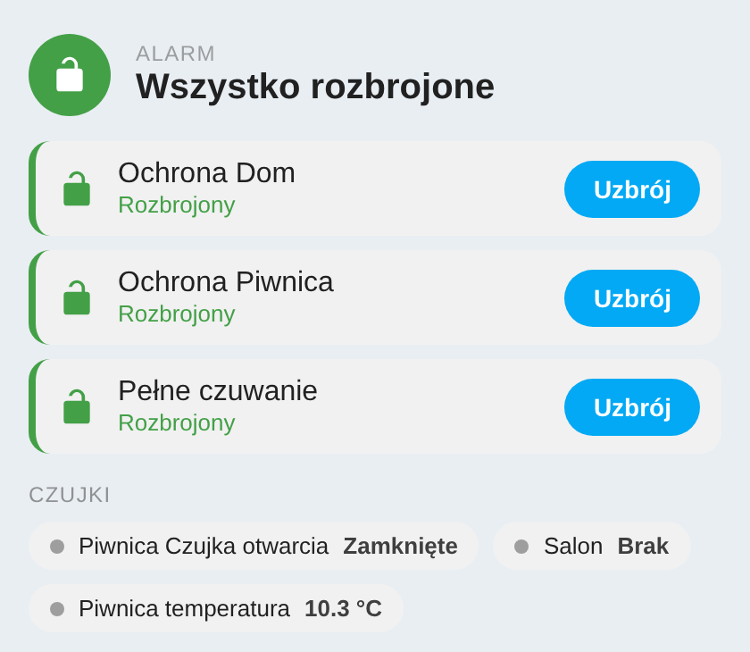
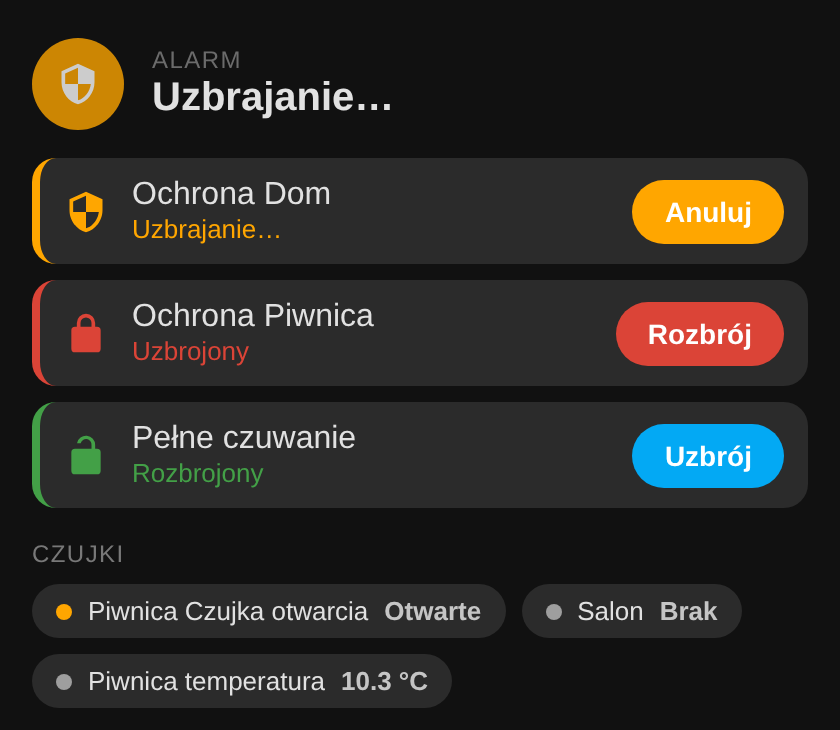

# BE WAVE (Satel) — Home Assistant integration (fork z obsługą HYBRID 128 Plus)

[](https://github.com/hacs/integration)

Lokalna integracja **Home Assistant** z alarmami **Satel BE WAVE** — bez chmury i bez
dodatkowego sprzętu. Łączy się bezpośrednio z centralą w Twojej sieci, na lokalnego użytkownika i hasło.

Ten projekt jest **forkiem** integracji [slaveitgr/Satel_BeWAVE_Home_Assistant-](https://github.com/slaveitgr/Satel_BeWAVE_Home_Assistant-),
rozszerzonym o obsługę centrali **BE WAVE HYBRID 128 Plus**.

## Podziękowania

Ogromne podziękowania dla **[slaveitgr](https://github.com/slaveitgr)** — autora oryginalnej
integracji. To on rozpracował protokół BE WAVE (logowanie, szyfrowanie, format wiadomości,
odczyt stanu, uzbrajanie), napisał klienta i całą integrację dla Smart HUB. Bez jego pracy
ten fork by nie powstał; moje zmiany to tylko dostosowanie do centrali HYBRID. 🙏

> _English:_ Huge thanks to **slaveitgr**, the author of the original integration, who
> reverse-engineered the BE WAVE protocol and built the client and the Home Assistant
> integration for the Smart HUB. This fork only adapts it to the HYBRID panel.

## Co działa

- 🔌 Połączenie lokalne w LAN, logowanie lokalnym użytkownikiem i hasłem
- 🛡️ **Osobna encja alarmu (`alarm_control_panel`) dla każdego trybu uzbrajania** czytanego z centrali, np. „Ochrona Piwnica", „Ochrona Dom" oraz **„Pełne czuwanie"** (tryb domyślny). Każdy tryb uzbrajasz i rozbrajasz niezależnie
- ⏳ Stan **„uzbrajanie"** podczas opóźnienia wyjścia (centrala potwierdza uzbrojenie dopiero po nim)
- 🔢 Opcjonalny **PIN** do uzbrajania i rozbrajania (sprawdzany w Home Assistant, z ekranową klawiaturą na karcie)
- 🔴 Odczyt stanu na żywo, także gdy tryb zmieniasz z aplikacji w telefonie
- 🚪 Czujki otwarcia i ruchu jako `binary_sensor`, temperatura i bateria jako `sensor`
- 🎛️ Przełączniki ustawień centrali (LED, GRADE 2, połączenie z serwerem SATEL)
- 🔑 Automatyczna rejestracja własnego identyfikatora urządzenia
- 🔒 Wszystko lokalnie, bez internetu

Sprawdzone na: **BE WAVE HYBRID 128 Plus, firmware 1.05** (alarm, tryby, stany urządzeń).
Oryginalnie wspierane: Smart HUB i Smart HUB Plus (fw 1.04) — ta wersja nie była na nich ponownie testowana.

## Co jest inne niż w oryginale

Centrala HYBRID mówi tym samym językiem co Smart HUB, ale jest bardziej wymagająca: zamyka połączenie, gdy
zapytania przychodzą za szybko albo gdy przez chwilę nic się nie dzieje, i odrzuca zapytania z niewłaściwymi
danymi użytkownika. Ten fork to naprawia, czyta tryby uzbrajania z centrali i pokazuje każdy jako osobną encję.
Szczegóły techniczne: [docs/TECHNICAL.md](docs/TECHNICAL.md).

## Karta do panelu (Lovelace)

W zestawie jest karta **`bewave-card`**: pokazuje każdy tryb jako kolorowy wiersz (zielony – rozbrojony,
pomarańczowy – uzbrajanie, czerwony – uzbrojony/alarm) z przyciskiem Uzbrój / Rozbrój / Anuluj,
oraz opcjonalnie czujki (otwarcie, ruch, temperatura). Działa w jasnym i ciemnym motywie, po polsku i angielsku.

<p> </p>

Karta ładuje się sama razem z integracją. Dodaj ją w edytorze panelu (**Dodaj kartę → Własna: BE WAVE alarm**)
albo w YAML. Najprostsza wersja sama znajdzie encje trybów:

```yaml
type: custom:bewave-card
title: Alarm
```

Z czujkami i własnymi nazwami:

```yaml
type: custom:bewave-card
title: Alarm
confirm_disarm: true          # pytaj przed rozbrojeniem (opcjonalnie)
entities:                     # opcjonalnie; bez tego karta znajdzie je sama
  - alarm_control_panel.be_wave_xxx_ochrona_dom
  - entity: alarm_control_panel.be_wave_xxx_ochrona_piwnica
    name: Piwnica
sensors:
  - binary_sensor.piwnica_czujka_otwarcia
  - sensor.piwnica_temperatura
```

Jeśli karta nie pojawia się na liście: Ustawienia → Panele → ⋮ → **Zasoby** → dodaj
`/bewave/bewave-card.js` jako *moduł JavaScript* i odśwież stronę (Ctrl+F5).

## Zabezpieczenie PIN-em

W opcjach integracji (Ustawienia → Urządzenia i usługi → BE WAVE → **Konfiguruj**) możesz ustawić **PIN**
(min. 4 znaki) i wybrać, czy jest wymagany do uzbrajania, rozbrajania, czy do obu. Wtedy:

- encje alarmu w Home Assistant wymagają kodu (standardowa karta *Alarm panel* też pokaże klawiaturę),
- karta `bewave-card` pokaże ekranową klawiaturę numeryczną (albo pole hasła, gdy PIN zawiera litery),
- w automatyzacjach i skryptach podajesz kod w wywołaniu usługi:

```yaml
action: alarm_control_panel.alarm_disarm
target:
  entity_id: alarm_control_panel.be_wave_xxx_ochrona_dom
data:
  code: "1234"
```

Po 5 błędnych kodach z rzędu rozbrajanie jest blokowane na 60 s.

> ⚠️ **To zabezpieczenie działa tylko w Home Assistant.** PIN jest sprawdzany przez HA i zapisany w jego
> konfiguracji (jawnym tekstem, jak inne opcje integracji). Nie chroni aplikacji BE WAVE, klawiatury
> centrali ani nikogo, kto ma pełny dostęp do HA (np. do jego plików lub narzędzi deweloperskich).
> Traktuj go jako ochronę przed przypadkowym lub niepowołanym kliknięciem w panelu, nie jako zamek.

## Instalacja (HACS)

1. HACS → ⋮ → **Custom repositories** → dodaj jako **Integration**:

   ```text
   https://github.com/danieltechdev/Satel_BeWAVE_Home_Assistant-hybrid
   ```
2. Zainstaluj **BE WAVE (Satel)** i zrestartuj Home Assistant.
3. Ustawienia → Urządzenia i usługi → **Dodaj integrację** → BE WAVE.
4. Podaj adres IP centrali, lokalnego użytkownika i hasło.

Instalacja ręczna: skopiuj `custom_components/bewave/` do `config/custom_components/bewave/`.

**Wskazówki:**
- Centrala ma ograniczoną liczbę równoczesnych sesji (oraz 5 urządzeń mobilnych na użytkownika).
  Przed pierwszą konfiguracją wyłącz starą integrację BE WAVE i zamknij aplikację na telefonie
  i w Windows. Najlepiej utwórz osobnego lokalnego użytkownika dla Home Assistant.
- Pierwsze logowanie trwa kilkanaście sekund — to normalne.
- Jeśli zamieniasz wcześniejszą wersję, usuń integrację i dodaj ją ponownie (zmieniły się encje).
- Pole „tryb" w opcjach jest używane tylko, gdy centrala nie zwróci listy trybów.

## Aktualizacja zainstalowanej wersji

**Przez HACS (zalecane):**
1. HACS → **Integracje** → BE WAVE (Satel) → ⋮ → **Pobierz ponownie / Update information**
   (albo ⋮ → *Redownload* i wybierz najnowszą wersję).
2. **Zrestartuj Home Assistant** (Ustawienia → System → ⋮ → Uruchom ponownie).
3. Odśwież przeglądarkę z wyczyszczeniem pamięci podręcznej (**Ctrl+F5**; w aplikacji mobilnej: Ustawienia
   aplikacji → Debugowanie → Resetuj lokalne zasoby), żeby załadować nową kartę.

**Ręcznie:** podmień folder `config/custom_components/bewave/` zawartością `custom_components/bewave/`
z repozytorium (razem z podfolderem `www/`), zrestartuj HA i odśwież przeglądarkę (Ctrl+F5).

**Po aktualizacji ze starej wersji** (oryginał slaveitgr lub wcześniejszy fork) usuń integrację
(Ustawienia → Urządzenia i usługi → BE WAVE → ⋮ → Usuń) i dodaj ją ponownie. Encje alarmu mają teraz
osobne identyfikatory dla każdego trybu. Przed dodaniem zamknij aplikację BE WAVE na telefonie.

## Znane ograniczenia

- Stan trybu jest wyliczany z urządzeń trybu (potwierdzone na HYBRID 128 Plus z trybami Piwnica/Dom/pełne
  czuwanie). Tryby bez przypisanych urządzeń nie dostaną własnej encji (poza domyślnym).
- Pełne czuwanie uzbraja także tryby składowe, więc ich encje pokażą „uzbrojony".
- Alarm „wyzwolony" jest wykrywany tylko po otwarciu czujki przy uzbrojonym alarmie.
- Brak obsługi chmury, przekaźników/wyjść i zdarzeń pilota.

## English summary

Local Home Assistant integration for Satel **BE WAVE** alarms (no cloud, no bridge), forked from
[slaveitgr's integration](https://github.com/slaveitgr/Satel_BeWAVE_Home_Assistant-) with
support for the **BE WAVE HYBRID 128 Plus** (verified on firmware 1.05).

The HYBRID panel needs paced requests, a keep-alive and the ids from its sign-in reply. Each arm mode becomes its own
`alarm_control_panel` entity, with a Lovelace card and an optional PIN. Details: [docs/TECHNICAL.md](docs/TECHNICAL.md).

Install via HACS as a custom repository (category *Integration*):
`https://github.com/danieltechdev/Satel_BeWAVE_Home_Assistant-hybrid`.

## Zastrzeżenie / Disclaimer

Nieoficjalna integracja społecznościowa, niezwiązana z firmą SATEL. Używa Twoich własnych
danych logowania do sterowania Twoim alarmem. Nie opieraj bezpieczeństwa obiektu wyłącznie
na integracji lub automatyzacji. Używasz na własną odpowiedzialność.
_Unofficial community integration, not affiliated with SATEL. Use at your own risk._

## Licencja / License

MIT — zob. [LICENSE](LICENSE). Oryginalny kod: slaveitgr; zmiany dla HYBRID: danieltechdev.
